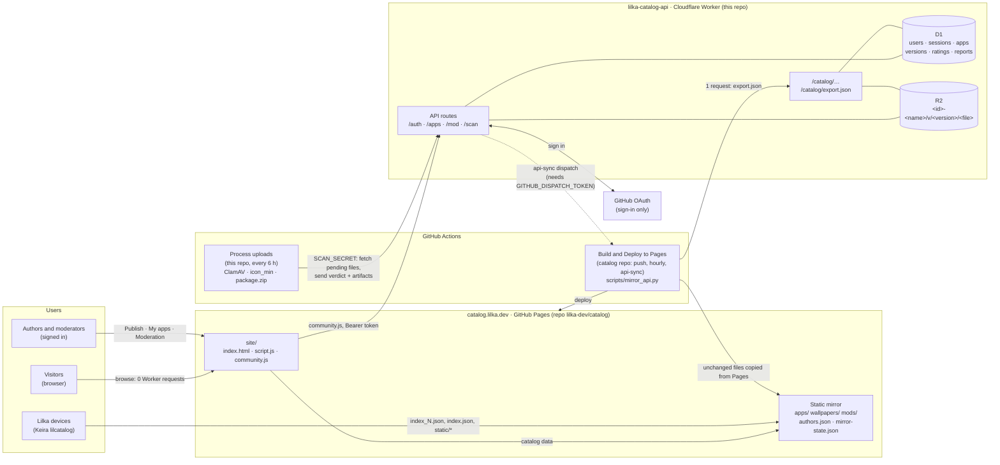
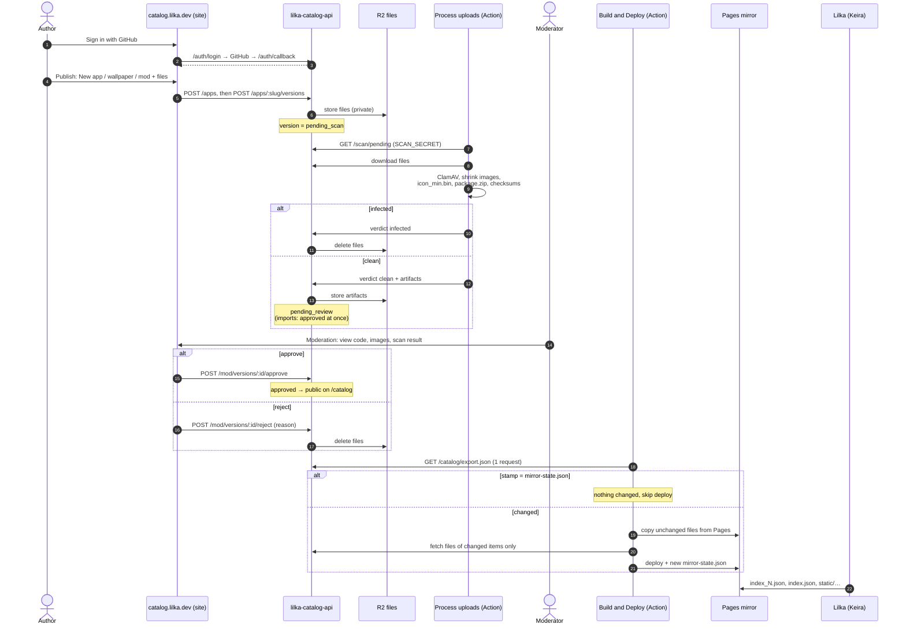
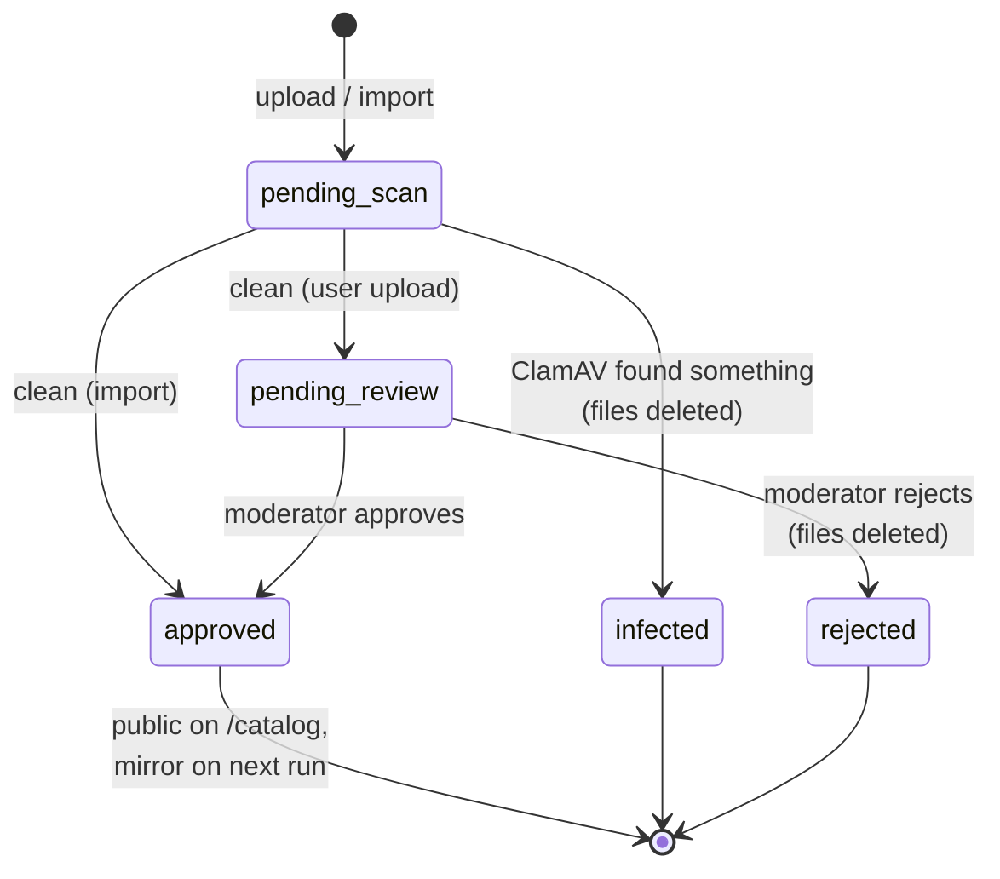

# lilka-catalog-api

The Lilka catalog: every app, wallpaper and mod on
[catalog.lilka.dev](https://catalog.lilka.dev), and the way people publish
them. It runs on Cloudflare: a Worker for the API, D1 (SQLite) for data, R2 for
files. The [catalog repo](https://github.com/lilka-dev/catalog) is only the
website and a static mirror for devices.



Every request that reaches the Worker counts against its daily limit, so
traffic that does not need an account never does: visitors and Lilka devices
read the Pages mirror, and the mirror itself costs one request per run
(`/catalog/export.json`) plus the files of items that changed.

`/catalog/...` serves exactly the files the old repo's `build.py` wrote to
Pages — same paths, same JSON fields in the same order, the same `icon_min.bin`
bytes — because Keira's `lilcatalog` reads them from
`https://catalog.lilka.dev` and shipped firmware cannot change that. The Pages
mirror is a plain copy of that tree.

## Lifecycle of an upload

1. `POST /apps` creates a **draft** app (slug, kind, names, descriptions, source URL).
2. `POST /apps/:slug/versions` uploads files → version is `pending_scan`. Files
   are private: only the owner and moderators can fetch them.
3. The processing workflow downloads them with the shared secret, scans every
   file with ClamAV and, when clean, uploads the compressed images, `icon_min`,
   `package.zip` and the checksum record → `pending_review`; or `infected`.
4. A moderator approves (`pending_review` only) → version `approved`, app
   `published`, the mirror rebuild is dispatched.
5. Owner or moderator can hide the app (`PATCH status: hidden`); it drops out
   of `/catalog` at once and out of the mirror on its next build.

Imported apps (below) skip step 4: they were reviewed as repo pull requests.



### Version status



## Storage layout

Each version's files are in R2 under `<app id>-<slug>/v/<version>/`, e.g.
`1-2048/v/1.0.0/twenty-forty-eight.lua`. The prefix is stored on the version
row (`storage_prefix`); rows created before migration 0002 keep `v/<version id>`.

## API

All bodies are JSON unless noted. Authenticated calls send
`Authorization: Bearer <token>`.

| Method | Path | Who | What |
|---|---|---|---|
| GET | `/auth/login?return=<url>` | anyone | Redirects to GitHub. `return` must be on `ALLOWED_ORIGINS` |
| GET | `/auth/callback` | GitHub | Redirects to `return#lilka_token=<token>` |
| POST | `/auth/logout` | user | Ends the session |
| GET | `/auth/me` | user | Current user |
| GET | `/catalog/{apps,wallpapers,mods}/index_<n>.json` | anyone | Ids of published items, 12 per page |
| GET | `/catalog/<dir>/<id>/index.json`, `index_short.json` | anyone | Manifests in build.py's format |
| GET | `/catalog/<dir>/<id>/static/<file>`, `package.zip` | anyone | Files; `?download` forces attachment |
| GET | `/catalog/authors.json` | anyone | Items grouped by author |
| GET | `/apps?kind=&q=&page=` | anyone | Published apps, 24 per page |
| GET | `/apps/:slug` | anyone / owner | Detail with versions; owner also sees drafts and statuses |
| POST | `/apps` | user | Create draft; `kind`: `app`, `wallpaper` or `mod` |
| PATCH | `/apps/:slug` | owner, mod | Edit metadata, `status: hidden \| published`; moderators also `author`, `owner` (login) |
| POST | `/apps/:slug/versions` | owner, mod | Multipart: `version`, `keira_version`, `entry_type` (`lua`, `js`, `binary`, `archive`), `changelog`, files `entry`, `files[]`, `icon`, `screenshots[]`. Mods: no entry, model files as `files[]` |
| PUT | `/apps/:slug/rating` | user (not owner) | `{ "stars": 1..5 }` |
| POST | `/apps/:slug/reports` | user | `{ "reason": "..." }` |
| GET | `/users/:login/apps` | anyone | Apps of a user (all of them for the user themself) |
| GET | `/files/:slug/:version/:name` | anyone if approved, owner, mod | File by version id; used by "My apps" and moderation previews |
| GET | `/mod/queue?status=` | mod | Versions by status, default `pending_review` |
| POST | `/mod/versions/:id/approve` | mod | `{ "note"?: "..." }` |
| POST | `/mod/versions/:id/reject` | mod | `{ "note": "reason" }` |
| GET | `/mod/reports` | mod | Open reports |
| POST | `/mod/reports/:id/resolve` | mod | |
| POST | `/mod/users/:login/ban` / `unban` | mod | Ban hides all their apps and ends sessions |
| POST | `/mod/import[?replace]` | mod | One app from the old repo (`scripts/import_catalog.py`) |
| GET | `/scan/pending`, `/scan/versions/:id`, `/scan/files/:id/:name` | processor | For `scripts/process.py` |
| POST | `/scan/versions/:id` | processor | Multipart: `result` (`clean` \| `infected`), `detail`, `security`, `icon_min`, `package`, files `artifact[]` |

Limits: 8 MB per file, 24 MB per upload, 16 extra files, 6 screenshots, 5
versions waiting for review per user. File names: letters, digits, `.`, `_`,
`-` (the catalog flattens files by name).

### Signing in from a page

```js
const API = 'https://lilka-catalog-api.<account>.workers.dev';

// Button
location.href = `${API}/auth/login?return=${encodeURIComponent(location.href)}`;

// On page load
const m = location.hash.match(/lilka_token=([^&]+)/);
if (m) {
    localStorage.setItem('lilka_token', m[1]);
    history.replaceState(null, '', location.pathname + location.search);
}
const token = localStorage.getItem('lilka_token');
const me = await fetch(`${API}/auth/me`, { headers: { Authorization: `Bearer ${token}` } });
```

Sessions are bearer tokens rather than cookies because the API is on a
different site than the catalog and browsers block third-party cookies.

## Local development

```bash
npm install
cp .dev.vars.example .dev.vars
npm run db:migrate:local
npm run dev            # http://localhost:8787
npm run smoke          # in another terminal: 52 end-to-end checks
npm run typecheck
```

GitHub sign-in does not work locally unless you create a separate OAuth App
with callback `http://localhost:8787/auth/callback`; `scripts/smoke.sh` writes
users and sessions straight into the local D1 instead.

The processor needs Python with `pip install -r requirements.txt` and ClamAV:

```bash
API_URL=http://localhost:8787 SCAN_SECRET=dev-scan-secret python3 scripts/process.py
```

## Deploying

Everything works on the free `*.workers.dev` address; no access to the
lilka.dev DNS is needed.

1. Create the resources and put the printed `database_id` into `wrangler.toml`:
   ```bash
   npx wrangler login
   npx wrangler d1 create lilka-catalog
   npx wrangler r2 bucket create lilka-catalog-files
   npm run db:migrate
   ```
2. Create a GitHub OAuth App (org `lilka-dev` → Settings → Developer settings
   → OAuth Apps). Callback URL: `https://lilka-catalog-api.<account>.workers.dev/auth/callback`.
3. In `wrangler.toml` set `PUBLIC_URL`, `GITHUB_CLIENT_ID`, `MODERATORS`, and
   trim `ALLOWED_ORIGINS` to production sites.
4. Secrets:
   ```bash
   npx wrangler secret put GITHUB_CLIENT_SECRET
   npx wrangler secret put SCAN_SECRET            # any long random string
   npx wrangler secret put GITHUB_DISPATCH_TOKEN  # fine-grained PAT: Contents read/write on catalog-api and catalog
   ```
5. `npm run deploy`
6. In this repo on GitHub: variable `API_URL`, secret `SCAN_SECRET` (same value).
7. In the catalog repo: variable `API_URL` = the Worker URL.

## Moving the old catalog repo in (one time)

1. `npm run db:migrate` (applies `0002_full_catalog.sql`), then `npm run deploy`.
2. Sign in on the catalog site as a moderator and copy `lilka-token` from the
   browser's localStorage.
3. From a checkout of the catalog repo that still has `apps/`, `wallpapers/`
   and `mods/`:
   ```bash
   pip install -r requirements.txt
   python3 scripts/import_catalog.py ../catalog --api https://lilka-catalog-api.black-ghost-ukraine.workers.dev --token <token>
   ```
   `--dry-run` reads everything without sending; `--replace` re-imports.
4. Run the "Process uploads" workflow here (or wait for its half-hourly run);
   imports publish themselves once clean.
5. Check `/catalog/apps/index_0.json`, then merge the catalog repo branch that
   removes `build.py` and the app folders. Its mirror refuses to publish an
   empty catalog, so merging too early keeps the old mirror on Pages.

Later, with lilka.dev on Cloudflare DNS, add a custom domain such as
`api.lilka.dev` to the Worker and update `PUBLIC_URL` and the OAuth callback.

## Not done yet

- "Publish" from the web IDE.
- A moderator UI for handing imported apps to their authors (the API has it:
  `PATCH /apps/:slug` with `owner`).
- Rate limiting beyond the pending-review cap (Cloudflare's rate limiting
  binding is the natural next step).
