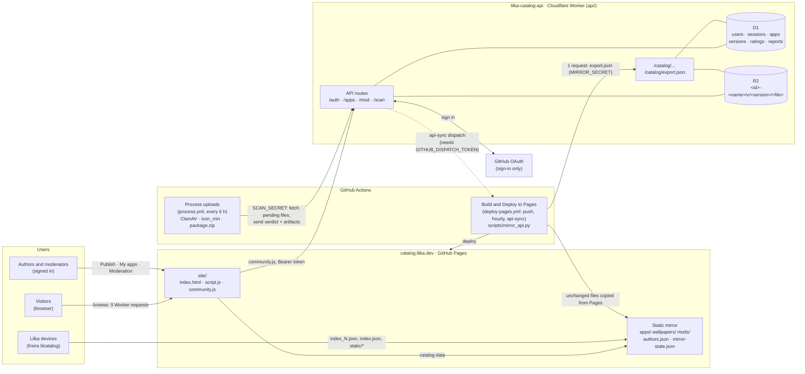
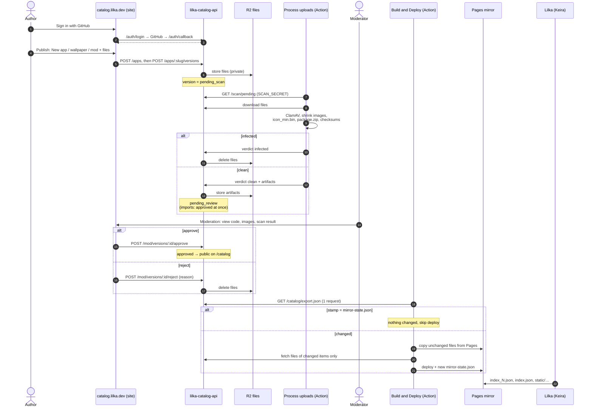
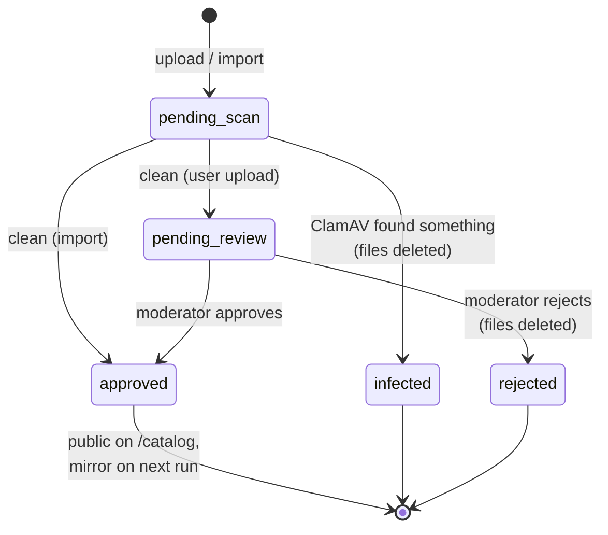

# lilka-catalog-api

The Lilka catalog: every app, wallpaper and mod on
[catalog.lilka.dev](https://catalog.lilka.dev), and the way people publish
them. It runs on Cloudflare: a Worker for the API, D1 (SQLite) for data, R2 for
files. It lives in `api/` of the [catalog repo](https://github.com/lilka-dev/catalog),
next to the website (`site/`) and the static mirror for devices (`scripts/mirror_api.py`).



Every request that reaches the Worker counts against its daily limit, so
traffic that does not need an account never does: visitors and Lilka devices
read the Pages mirror, and the mirror itself costs one request per run
(`/catalog/export.json`) plus the files of items that changed.

`/catalog/...` serves exactly the files the old repo's `build.py` wrote to
Pages — same paths, same JSON fields in the same order, the same `icon_min.bin`
bytes — because Keira's `lilcatalog` reads them from
`https://catalog.lilka.dev` and shipped firmware cannot change that. The Pages
mirror is a plain copy of that tree.

## Lifecycle of an upload

1. `POST /apps` creates a **draft** app (slug, kind, names, descriptions, source URL).
2. `POST /apps/:slug/versions` uploads files → version is `pending_scan`. Files
   are private: only the owner and moderators can fetch them.
3. The processing workflow downloads them with the shared secret, scans every
   file with ClamAV and, when clean, uploads the compressed images, `icon_min`,
   `package.zip` and the checksum record → `pending_review`; or `infected`.
4. A moderator approves (`pending_review` only) → version `approved`, app
   `published`, the mirror rebuild is dispatched.
5. Owner or moderator can hide the app (`PATCH status: hidden`); it drops out
   of `/catalog` at once and out of the mirror on its next build.

Imported apps (below) skip step 4: they were reviewed as repo pull requests.

When a run of the processing workflow leaves items waiting for review, its
`notify` job opens an issue labelled `moderation` assigned to the moderators
(or comments on the open one), so GitHub sends them an email and a push
notification. The issue only holds counts, because the repository is public.
Who gets it: the `MODERATION_NOTIFY` repository variable, comma-separated
logins, `black-ghost-off` by default. Close the issue once the queue is empty.



### Version status



## Storage layout

Each version's files are in R2 under `<app id>-<slug>/v/<version>/`, e.g.
`1-2048/v/1.0.0/twenty-forty-eight.lua`. The prefix is stored on the version
row (`storage_prefix`); rows created before migration 0002 keep `v/<version id>`.

## API

All bodies are JSON unless noted. Authenticated calls send
`Authorization: Bearer <token>`.

| Method | Path | Who | What |
|---|---|---|---|
| GET | `/auth/login?return=<url>` | anyone | Redirects to GitHub. `return` must be on `ALLOWED_ORIGINS`; the OAuth state is signed, nothing is stored |
| GET | `/auth/callback` | GitHub | Redirects to `return#lilka_token=<token>` |
| POST | `/auth/logout` | user | Ends the session |
| GET | `/auth/me` | user | Current user and `ratings` (slug → stars) they gave, so the site shows them without a request per app |
| GET | `/catalog/{apps,wallpapers,mods}/index_<n>.json` | mirror job | Ids of published items, 12 per page |
| GET | `/catalog/<dir>/<id>/index.json`, `index_short.json` | mirror job | Manifests in build.py's format |
| GET | `/catalog/<dir>/<id>/static/<file>`, `package.zip` | mirror job | Files |
| GET | `/catalog/authors.json` | mirror job | Items grouped by author line (build.py's format) |
| GET | `/catalog/authors_info.json` | mirror job | The website's Authors tab: one entry per person (GitHub logins merged ignoring case), public GitHub profile of authors who signed in, Printables links for mod authors, item counts and dates |
| GET | `/catalog/export.json` | mirror job | Everything above in one response, plus versions and a stamp |
| GET | `/apps?kind=&q=&page=` | user | Published apps, 24 per page |
| GET | `/apps/:slug` | user / owner | Detail with versions; owner also sees drafts and statuses |
| POST | `/apps` | user | Create draft; `kind`: `app`, `wallpaper` or `mod` |
| PATCH | `/apps/:slug` | owner, mod | Edit metadata, `status: hidden \| published`; moderators also `author`, `owner` (login) |
| POST | `/apps/:slug/versions` | owner, mod | Multipart: `version`, `keira_version`, `entry_type` (`lua`, `js`, `binary`, `archive`), `changelog`, files `entry`, `files[]`, `icon`, `screenshots[]`. Mods: no entry, model files as `files[]` |
| PUT | `/apps/:slug/rating` | user (not owner) | `{ "stars": 1..5 }` → `{ my_rating, average, count }`; sending the same stars again writes nothing |
| DELETE | `/apps/:slug/rating` | user | Removes your rating |
| POST | `/apps/:slug/reports` | user | `{ "reason": "..." }` |
| GET | `/users/:login/apps[?versions]` | user | Apps of a user (all of them, with versions, for the user themself or a moderator) |
| GET | `/files/:slug/:version/:name` | owner, mod | File by version id, for "My apps" and moderation previews |
| GET | `/mod/queue?status=` | mod | Versions by status, default `pending_review` |
| GET | `/mod/apps` | mod | Every item with owner, creator, version and pending counts, rating, open reports |
| DELETE | `/mod/apps/:slug` | mod | `{ "confirm": "<slug>" }`: deletes the item, its versions, ratings, reports and R2 files |
| GET | `/mod/users` | mod | Everyone who has signed in, with role, trusted, note flag and item count |
| GET | `/mod/users/:login` | mod | Profile, note, trusted, activity (created, ratings, sessions, last sign-in), items, reports filed |
| PATCH | `/mod/users/:login` | mod | `{ "trusted"?: bool, "note"?: string \| null }`; trusted lifts the per-account item limits |
| POST | `/mod/users/:login/sign-out` | mod | Ends every session of the user |
| DELETE | `/mod/users/:login/ratings` | mod | Removes every rating the user gave |
| POST | `/mod/versions/:id/approve` | mod | `{ "note"?: "..." }` |
| POST | `/mod/versions/:id/reject` | mod | `{ "note": "reason" }` |
| GET | `/mod/reports[?slug=]` | mod | Open reports, or every report on one item |
| POST | `/mod/reports/:id/resolve` | mod | |
| POST | `/mod/users/:login/ban` / `unban` | mod | Ban hides all their apps and ends sessions |
| POST | `/mod/import[?replace]` | mod | One app from the old repo (`scripts/import_catalog.py`) |
| GET | `/scan/pending`, `/scan/versions/:id`, `/scan/files/:id/:name` | processor | For `scripts/process.py` |
| POST | `/scan/versions/:id` | processor | Multipart: `result` (`clean` \| `infected`), `detail`, `security`, `icon_min`, `package`, files `artifact[]` |

"mirror job" means `Authorization: Bearer <MIRROR_SECRET>`, "processor"
`Bearer <SCAN_SECRET>`; both fail closed when the secret is not set.

Limits: 8 MB per file, 24 MB per upload, 16 extra files, 6 screenshots, 5
versions waiting for review per user. File names: letters, digits, `.`, `_`,
`-` (the catalog flattens files by name).

### Signing in from a page

```js
const API = 'https://lilka-catalog-api.<account>.workers.dev';

// Button
location.href = `${API}/auth/login?return=${encodeURIComponent(location.href)}`;

// On page load
const m = location.hash.match(/lilka_token=([^&]+)/);
if (m) {
    localStorage.setItem('lilka_token', m[1]);
    history.replaceState(null, '', location.pathname + location.search);
}
const token = localStorage.getItem('lilka_token');
const me = await fetch(`${API}/auth/me`, { headers: { Authorization: `Bearer ${token}` } });
```

Sessions are bearer tokens rather than cookies because the API is on a
different site than the catalog and browsers block third-party cookies.

## Local development

```bash
cd api
npm ci
cp .dev.vars.example .dev.vars   # dev placeholders; set GITHUB_CLIENT_SECRET to any value
npm run db:migrate:local
npm run dev            # http://localhost:8787
npm run smoke          # in another terminal: 86 end-to-end checks
npm run typecheck
```

GitHub sign-in does not work locally unless you create a separate OAuth App
with callback `http://localhost:8787/auth/callback`; `scripts/smoke.sh` writes
users and sessions straight into the local D1 instead.

To see the website with local data, mirror the local API into `site/`:

```bash
MIRROR_SECRET=dev-mirror-secret python3 ../scripts/mirror_api.py --api http://localhost:8787 --out ../site
```

The processor needs Python with `pip install -r requirements.txt` and ClamAV:

```bash
API_URL=http://localhost:8787 SCAN_SECRET=dev-scan-secret python3 scripts/process.py
```

## Deploying

Pushes to `main` that touch `api/` deploy through `.github/workflows/api.yml`:
tests, then `wrangler d1 migrations apply --remote`, then the Worker secrets
are copied from the repository's Actions secrets, then `wrangler deploy`.
Pull requests run the tests only, without any secret.

Repository → Settings → Secrets and variables → Actions:

| Secret | What | Used by |
|---|---|---|
| `CLOUDFLARE_API_TOKEN` | API token, account `ae0e107d…`: *Workers Scripts: Edit*, *D1: Edit*, *Workers R2 Storage: Read* | api.yml deploy |
| `SCAN_SECRET` | long random string | process.yml and the Worker |
| `MIRROR_SECRET` | long random string | deploy-pages.yml and the Worker |
| `OAUTH_CLIENT_SECRET` | GitHub OAuth App client secret (optional: the Worker keeps its own) | the Worker |
| `DISPATCH_TOKEN` | fine-grained PAT for `lilka-dev/catalog` only, *Contents: Read and write* (optional; without it uploads wait for the 6-hourly run and approvals for the hourly mirror) | the Worker |

GitHub does not allow secret names starting with `GITHUB_`, hence the two
renamed ones; the workflow maps them to the Worker's names.

## Protection against floods

Every request that reaches the Worker counts against its free daily limit
(100k), and on `workers.dev` nothing can be filtered before it arrives. What
the code controls is what a request costs:

- visitors and Lilka devices read the Pages mirror, never the Worker;
- nothing anonymous touches the database beyond one indexed lookup:
  `/catalog` and `/scan` need a secret, `/apps`, `/users` and `/files` a
  session, and the OAuth state is signed instead of stored;
- catalog queries join through `apps.latest_version_id` (migration 0003), a
  few rows per item instead of a scan per item;
- rate limits per IP (300/min), per user for writes (60/min) and uploads
  (10/min) run before any database work;
- per account: 3 new items a day, 20 in all (both count items the user
  created, not imports handed over to them), 5 versions waiting for review
  (moderators are exempt);
- on the free plan the limits are hard caps: a flood can stop the API until
  00:00 UTC, but never costs money. Do not move to a paid plan without a
  custom domain in front of the Worker.

With access to a domain on Cloudflare DNS, the remaining step is to serve the
Worker there (e.g. `api.lilka.dev`), turn off `workers.dev`, and add a WAF
rate-limiting rule: requests the WAF blocks never reach the Worker and do not
count against the limit.

## Moving the old catalog repo in (done)

The old repository's apps were imported with `scripts/import_catalog.py`
(`--dry-run` to read only, `--replace` to re-import). It is kept for reference.

## Not done yet

- "Publish" from the web IDE.
- A custom domain with WAF rules in front of the Worker (needs DNS access).
